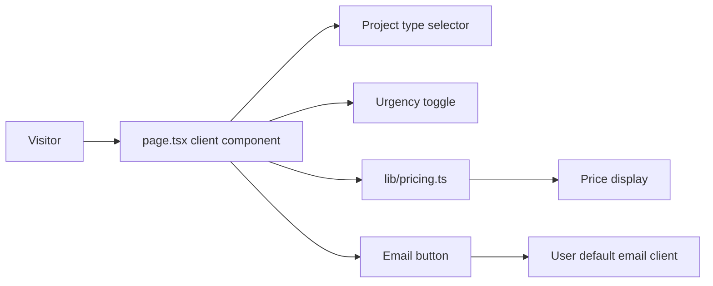

# Architecture — Price Calculator

## Architecture at a glance

The product is a static Next.js App Router site. The landing page is a client
component: it owns the currently selected project type and urgency, derives the
price through a pure pricing module, and creates the email CTA locally. No
request, persistence, authentication, analytics, or backend runtime is part of
this release.



## Decisions developers must follow

1. Keep pricing as a pure, typed function in `src/lib/pricing.ts`. Components
   pass a project-type identifier and urgency boolean; they do not duplicate
   prices, surcharge calculation, display formatting, or mailto encoding.
2. Keep UI state in the page-level client component. Presentational components
   receive typed props and notify the parent through callbacks; they do not own
   competing copies of selected project type, urgency, or total.
3. Build the email link from the same calculated total shown on screen. Use
   `URLSearchParams` (or equivalent standards-based encoding) for its subject
   and body. The recipient and subject are the PRD values.
4. The supplied default platform stack is not activated for this static scope:
   do not add FastAPI, PostgreSQL, containers, secrets, or server endpoints.
   A later persistence or lead-capture feature requires an architecture update.
5. Treat 375px and 1280px as first-class viewports. Layout must have a fluid
   container, `max-width`, and no element that can force horizontal overflow.

## Repository seed

```text
src/
  app/
    page.tsx                 # page state and composition
    globals.css              # tokens and responsive layout
  components/
    ProjectTypeSelector.tsx
    UrgencyToggle.tsx
    PriceDisplay.tsx
    EmailButton.tsx
  lib/
    pricing.ts               # price table, calculation, formatting, mailto data
tests/
  unit/                      # pricing-function tests
e2e/
  price-calculator.spec.ts   # visible behavior and responsive checks
```

## Test boundary

Unit tests cover all six project-type/urgency price combinations and mailto
input construction. Playwright covers the acceptance criteria: immediate
updates without a navigation, email-link destination/content, and no horizontal
scroll at 375px and 1280px. Tests assert the user-visible text rather than a
specific implementation detail.

## Operational boundary

The initial deployment is a static web build served over HTTPS. The browser's
configured mail client handles the CTA after it receives the generated
`mailto:` link. There are no credentials, migrations, scheduled jobs, logs, or
application data to operate in this release.

## Deferred

- A backend, database, saved quotes, analytics, and authentication are outside
  the approved scope. Revisit only if a future PRD adds server-side behavior.
- Hosting provider and deployment pipeline are not selected by the PRD; the
  static build must remain portable until that decision is needed.
